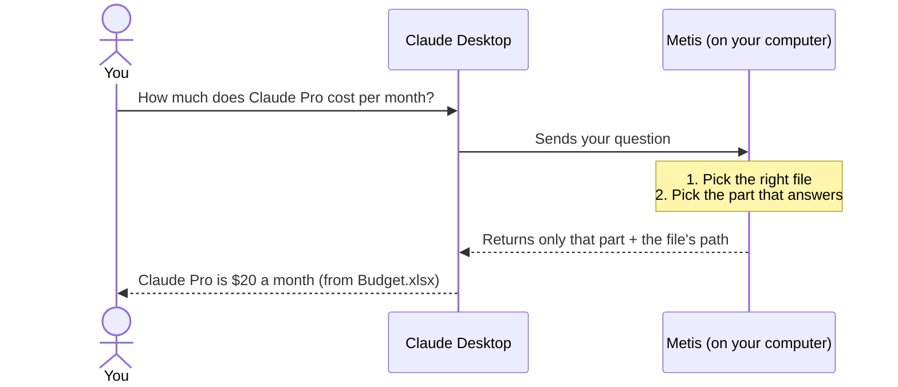

# Metis

**Claude connector for FASTER RETRIEVAL of context at NO cost.**

Metis lets Claude Desktop answer from the files on your computer without reading whole folders. Claude asks Metis
once; Metis finds the right file and the exact part that answers, and sends back only that part plus the file's path.
Fewer tokens, faster answers, and the search itself is free: it runs on two small local models, not on paid API calls.
Your files never leave your computer.

<!-- Comparison video: Claude with vs without Metis -->

<!-- Screenshots of the Metis app -->

## How it works



Before the first question, Metis reads each shared folder once (and again only when a file changes), cutting every
file into short excerpts it can search quickly.

Two local models share the work:

- **bge-small** (an embedding model) turns text into numbers so meaning can be compared. It's fast but rough,
  so it narrows the options.
- **[Laya](https://github.com/NandhaKishorM/laya)** (a decision model) doesn't write text. Given a question and a few
  options, it returns a probability for each, so it makes the final picks.

Each step narrows the next one, like a funnel: every excerpt → a few files → a handful of excerpts →
one answer. Supported files: `.txt`, `.md`, `.csv`, `.json`, `.pdf`, `.docx`, `.xlsx`. More detail:
[docs/core.md](docs/core.md).

## Install (Windows)

You need [Python 3.10 or newer](https://www.python.org/downloads/) (tick "Add python.exe to PATH" when installing)
and [Claude Desktop](https://claude.ai/download).

1. Download Metis: the green **Code** button → **Download ZIP**, then unzip it somewhere permanent (for example
   `Documents\metis`). Or: `git clone https://github.com/ItzJLaugh/metis.git`
2. Double-click **`install.bat`**. It sets up Metis in its own folder, downloads the two models (about 1.5 GB, once),
   and adds a **Metis** shortcut to your desktop. If you have an NVIDIA GPU it offers the faster GPU version.

Nothing is installed system-wide. macOS and Linux are untested; see [Manual install](#manual-install).

## Use it

1. Open **Metis** from your desktop.
2. Click **+ Add folder…** and pick a folder Metis may read. It reads every file once, which can take a few minutes
   for a large folder; after that only changed files are re-read.
3. Fully quit Claude Desktop (right-click its icon in the system tray → Quit), then click **Connect** next to
   Claude Desktop in Metis.
4. Open Claude Desktop again.
5. Ask Claude something your files can answer. Claude calls Metis's `request` tool and answers from the excerpt it
   gets back, with the file's path.

The app also shows what Metis shared with Claude today, has a **Test the connection** box to try a question
yourself, and an on/off switch at the top.

## Troubleshooting

- **Claude doesn't use Metis:** quit Claude Desktop from the system tray (closing the window isn't enough), click
  Connect in Metis (it should say "Connected"), then reopen Claude Desktop.
- **The first question is slow:** Metis loads its models when Claude starts (about 10 seconds).
- **Answers are slow (around 10 s):** that's the CPU. With an NVIDIA GPU, run `install.bat` again and answer `y`
  to the GPU question (about 1 s per answer).
- **A file isn't found:** check its type is supported and it isn't password-protected. Scanned PDFs (images of
  text) have no text to read.

## Privacy

Metis only reads the folders you add, and never changes or uploads them. Its index, settings and logs stay in
`%USERPROFILE%\.metis`. The models are downloaded once from Hugging Face; after that Metis works offline.
`~/.metis/decisions.jsonl` records each lookup (question, options, choice) on your computer only, to help improve
Metis later. To remove Metis: click **Disconnect** in the app, then delete the Metis folder and
`%USERPROFILE%\.metis`.

## How well it works

`bench/sample/TechSolutions` is a made-up company for testing Metis: 25 files (Word, PDF, Excel, CSV, Markdown,
JSON and text) in 14 folders. `bench/questions_sample.jsonl` has 36 questions about it: 31 answered somewhere in
the files and 5 that aren't, where Metis should say nothing was found.

On it, Metis finds the right folder 30/31, the right file 30/31 and the exact right part 28/31 times, and says
"not found" for 3 of the 5 questions with no answer. A question takes about 0.3 s on a laptop GPU or about 7 s on
the CPU.

To run it:

1. In the Metis app, share only `bench\sample\TechSolutions` (remove your other folders while testing).
2. Fully quit Claude Desktop, so its copy of Metis isn't holding the GPU.
3. Run:

```
.venv\Scripts\python bench/run.py --questions bench/questions_sample.jsonl --step "sample"
```

The last line shows how often Metis found the right folder, file and part, how often it said "not found", and the
time per question. To measure Metis on your own folders, copy `bench/questions.example.jsonl` to
`bench/questions.jsonl`, write questions about your files, and run the same command without `--questions`.

## Manual install

```
python -m venv .venv
.venv\Scripts\activate            # macOS/Linux: source .venv/bin/activate
pip install -r connector/requirements.txt
cd connector
python -m metis_mcp.app
```

For an NVIDIA GPU: `pip install "torch==2.14.1+cu130" --index-url https://download.pytorch.org/whl/cu130`.
Set `LAYA_DEVICE=cpu` to force the CPU.

## Project files

- `install.bat` / `install.ps1`: the installer; `start-metis.bat`: opens the app
- `connector/metis_mcp/core.py`: indexing, search and the decision log ([docs/core.md](docs/core.md))
- `connector/metis_mcp/server.py`: the `request` tool Claude calls
- `connector/metis_mcp/app.py` + `app.html`: the desktop app
- `connector/compare.py`: time and token cost of Claude with vs without Metis (needs an Anthropic API key)
- `bench/`: the benchmark scorer, the sample company (`bench/sample/`) with its questions, and an example question file
- `docs/build-plan.md`: what's next

## License

Apache License 2.0, see [LICENSE](LICENSE). Metis downloads Laya (Apache 2.0) and bge-small (MIT) from Hugging Face
on first run; their own licenses apply to them.
